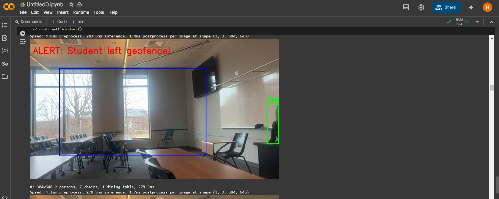
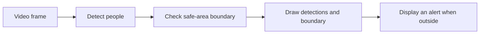

# Geofencing AI | Visual Boundary-Monitoring Prototype

**Python · YOLOv8 · OpenCV · Computer Vision · Geofencing**

A computer-vision prototype that explores how video-based person detection can flag when someone moves outside a defined safe area. The project was developed for the **AI Club & Voxel51 Hackathon on March 9, 2025**, with a child-safety use case in mind.



*Example output from the repository: a blue boundary, a detected person, and an on-screen alert.*

## The idea

During activities such as school recess, supervisors may need to monitor a designated area. This prototype explores using object detection and a visual boundary to draw attention to a possible boundary crossing.

## What the prototype demonstrates

- **Person detection:** use YOLOv8 to identify people in video frames.
- **Visual geofence:** define and display a safe-area boundary.
- **Boundary alert:** show an on-screen warning when a detected person is outside the defined area.
- **Video processing:** use OpenCV to work with frames and display annotations.

The existing project README also describes a Flask web interface; its setup and operation have not been independently verified.

## How it works



## Demonstration and results

The screenshot above shows a sample frame with an outside-geofence alert. This is a **visual prototype demonstration**; the repository does not establish a measured accuracy, false-alert rate, or real-time performance benchmark. Those would require a documented evaluation across representative videos.

## Technologies

| Tool | Role |
|---|---|
| YOLOv8 | Person detection |
| OpenCV / cv2 | Video processing and visual annotations |
| NumPy | Geofence geometry |
| Google Colab | Notebook environment |
| COCO 2017 | Dataset named in the project presentation |
| Flask | Web interface described in the original README |

## Explore the project

- [Open the project notebook](Geofencing_AI.ipynb)
- [View the hackathon presentation](Geo%20Fencing%20Model_%20Safety%20System%20-%20FiftyOne%20Hackthon%20.pdf)
- [View the notebook PDF](Untitled0.ipynb%20-%20Colab.pdf)

To get a local copy:

```bash
git clone https://github.com/HIRAL13CHOKSI/Geofencing-AI.git
```

The repository contains a large notebook and does not currently include a verified, complete environment setup. Review the notebook's dependencies and input requirements before running it.

## Next steps

The hackathon presentation identifies larger-scale testing, feedback, and multi-camera support as possible future work. A stronger next evaluation would measure detection and boundary-alert performance across varied lighting, occlusion, and camera views.

This is an experimental prototype and should not be relied on as a standalone child-safety or emergency-alert system.

## Team

Developed by **Aniruddh Nair, Hiral Choksi, Musarah Muhammad, and Anan Khan** for the AI Club & Voxel51 Hackathon.

## Skills demonstrated

Object detection · video processing · geofencing · computer vision · prototype development · technical communication
